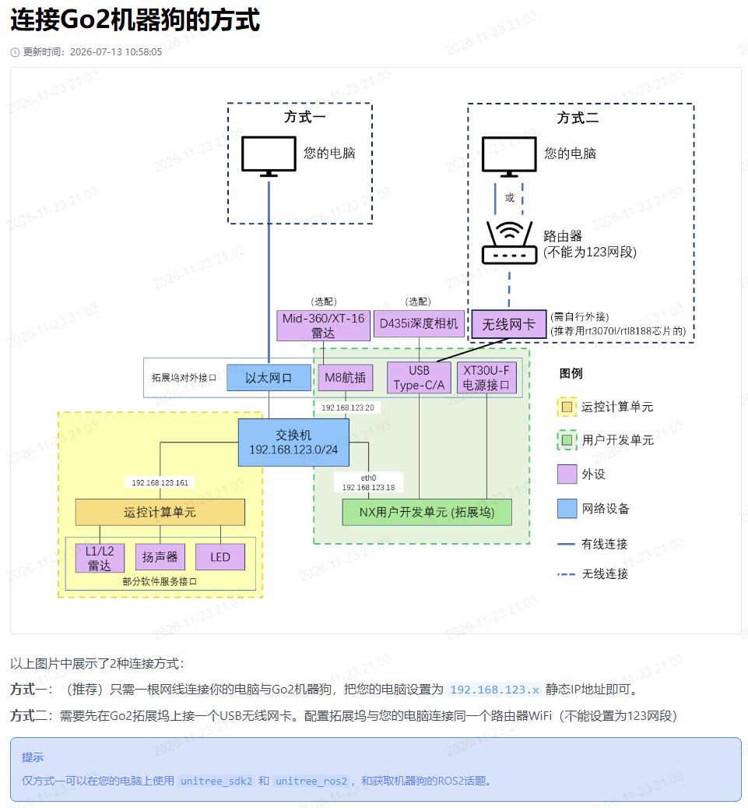

# Unitree Go2 基础环境配置与网线直连验证指南（详细版）

- **文件名**：`c01_env_setup_guide.md`
- **适用平台**：**Unitree Go2** 四足机器人
- **适用系统**：**Ubuntu 20.04 LTS** + **ROS 2 Foxy**
- **文档目标**：从零完成 Ubuntu 20.04 下的 ROS 2 Foxy 与 `unitree_ros2` 环境搭建，并通过网线直连 Go2 成功打印实机 `ros2 topic list`。
- **操作习惯提示**：下载软件、修改系统配置或网卡参数时，建议同步做好本地记录，便于后续回溯与排查。
- **其他**：本教程依照bilibili宇树support所发布的话题，如果后面cyclonedds相关那部分编译失败，请参考G1教程：https://support.unitree.com/home/zh/G1_developer/ros2_communication_routine

---

# 目录

- [环境参数与网络拓扑](#环境参数与网络拓扑)
- [安装ROS2与基础依赖](#安装ros2与基础依赖)
- [下载与编译unitree_ros2](#下载与编译unitree_ros2)
- [网线直连配置与话题验证](#网线直连配置与话题验证)
- [常见故障排除](#常见故障排除)

---

# 环境参数与网络拓扑

本部分汇总 Go2 实机网线直连的默认网段、设备 IP 分配及开发环境的红线规范，后续所有配置与排错均以本节参数为基准。

>注意：本文档所有命令均基于 **Ubuntu 20.04 (ROS 2 Foxy)** 编写，其他系统版本（如 Ubuntu 22.04 Humble）请勿直接照搬。

## 1 Go2 内部网络与直连 IP 参数

使用一根网线直连开发主机与 Go2 机身以太网口时，所有设备均处于 `192.168.123.0/24` 网段 。


| 设备/单元 | IP 地址 | 说明 |
| --- | --- | --- |
| 运控计算单元 | `192.168.123.161` | 机器狗底层运控主机，默认常驻运控服务 |
| NX 用户开发单元（拓展坞） | `192.168.123.18` | 机载电脑，SSH 账号 `unitree`，默认密码 `123` |
| 激光雷达 / M8 航插 | `192.168.123.20` | 选配 Mid-360 / XT-16 雷达默认地址 |
| 开发主机（Ubuntu 20.04） | `192.168.123.99` | 静态 IP，可任选 `192.168.123.x`（避开 `.161`/`.18`/`.20`） |
| 子网掩码 | `255.255.255.0` | 掩码长度 `/24`，默认网关留空 |

## 2 环境隔离与虚拟环境使用原则

>注意：在安装 ROS 2 依赖、编译 **CycloneDDS** 与 **unitree_ros2** 以及运行 ROS 2 命令行工具时，**严禁开启 Conda 或 Python 虚拟环境**。ROS 2 Foxy 强依赖系统原生 `/usr/bin/python3`（Python 3.8），处于 `(base)` 或其他虚拟环境极易导致 `colcon build` 报错或 `rclpy` 导入失败。

---

# 安装ROS2与基础依赖

本模块完成 Ubuntu 20.04 下 **ROS 2 Foxy**、**CycloneDDS** 相关插件及编译工具链的安装，并通过本机节点通信测试确认基础环境无误。

## 1 确认退出虚拟环境并安装基础工具

- 若终端命令提示符前显示 `(base)` 或其他虚拟环境名，先退出虚拟环境并核对 Python 路径：

```bash
conda deactivate    # 退出 Conda 虚拟环境（未安装 Conda 可忽略）
which python3       # 预期输出 /usr/bin/python3
python3 --version   # 预期输出 Python 3.8.x
```

- 更新系统软件源并安装基础编译、网络及文本编辑工具：

```bash
sudo apt update
sudo apt install -y curl gnupg2 lsb-release git cmake build-essential net-tools gedit
```

## 2 安装 ROS 2 Foxy

>注意：本步骤安装 ROS 系统级依赖，**不要开启任何虚拟环境**。

### 2.1 配置编码与官方软件源

- 检查并配置系统 `UTF-8` 编码环境：

```bash
locale    # 检查是否包含 UTF-8
sudo apt update && sudo apt install -y locales
sudo locale-gen en_US en_US.UTF-8
sudo update-locale LC_ALL=en_US.UTF-8 LANG=en_US.UTF-8
export LANG=en_US.UTF-8
```

- 启用 Ubuntu Universe 仓库并添加 ROS 2 GPG 密钥与软件源：

```bash
sudo apt install -y software-properties-common
sudo add-apt-repository universe
sudo curl -sSL https://raw.githubusercontent.com/ros/rosdistro/master/ros.key -o /usr/share/keyrings/ros-archive-keyring.gpg
echo "deb [arch=$(dpkg --print-architecture) signed-by=/usr/share/keyrings/ros-archive-keyring.gpg] http://packages.ros.org/ros2/ubuntu $(. /etc/os-release && echo $UBUNTU_CODENAME) main" | sudo tee /etc/apt/sources.list.d/ros2.list > /dev/null
```

*备注1：若国内网络拉取官方源或密钥超时，可配置代理，或使用鱼香 ROS 一键安装脚本 `wget http://fishros.com/install -O fishros && . fishros` 选择安装 ROS 2 Foxy 桌面版。注意：一键脚本通常会自动向 `~/.bashrc` 写入 `source /opt/ros/foxy/setup.bash`，在下一章编译 `cyclonedds` 前必须按要求先将其注释。*

### 2.2 安装 ROS 2 Foxy 桌面版及 CycloneDDS 依赖

- 安装 **ros-foxy-desktop**、**CycloneDDS** 依赖包、IDL 生成器及 `colcon` 编译工具：

```bash
sudo apt update
sudo apt install -y ros-foxy-desktop \
  ros-foxy-rmw-cyclonedds-cpp \
  ros-foxy-rosidl-generator-dds-idl \
  python3-colcon-common-extensions
```

## 3 中途测试：验证 ROS 2 本地通信

在下载宇树功能包之前，先通过官方示例节点验证本机 ROS 2 Foxy 是否工作正常。

- 打开**终端 1**，手动加载 Foxy 环境并启动发布节点 `talker`：

```bash
source /opt/ros/foxy/setup.bash
ros2 run demo_nodes_cpp talker
```

- 打开**终端 2**，手动加载 Foxy 环境并启动订阅节点 `listener`：

```bash
source /opt/ros/foxy/setup.bash
ros2 run demo_nodes_py listener
```

- 通信正常时，终端 2 会持续打印如下信息：

```text
[INFO] [listener]: I heard: [Hello World: 1]
[INFO] [listener]: I heard: [Hello World: 2]
[INFO] [listener]: I heard: [Hello World: 3]
```

- 验证通过后，在两个终端分别按 `Ctrl+C` 退出测试，并关闭这两个已经 `source` 过 ROS 2 环境的终端。

---

# 下载与编译unitree_ros2

本模块拉取宇树官方 **unitree_ros2** 仓库，并严格按照“**清理 ROS 2 环境变量 -> 单独编译 CycloneDDS 0.10.x -> 激活 Foxy 全量编译**”的顺序完成构建。

官方文档与源码参考：
- 宇树 `unitree_ros2` 仓库：`https://github.com/unitreerobotics/unitree_ros2`
- ROS 2 更换 DDS 中间件说明：`https://docs.ros.org/en/foxy/Concepts/About-Different-Middleware-Vendors.html`

## 1 克隆 unitree_ros2 仓库

- 将仓库克隆至用户主目录：

```bash
cd ~
git clone https://github.com/unitreerobotics/unitree_ros2.git
```

## 2 编译 cyclone-dds（关键步骤）

由于 Go2 使用的是 **cyclonedds 0.10.2** 版本，因此需要先更换并单独编译对应版本的 ROS 2 DDS 实现。

>注意：**编译 `cyclonedds` 前必须确保当前终端在启动时完全没有 `source` 任何 ROS 2 相关的环境变量**，否则会导致 `cyclonedds` 编译报错。如果安装 ROS 2 时（尤其是使用一键脚本时）在 `~/.bashrc` 中添加了 `source /opt/ros/foxy/setup.bash`，**必须先修改 `~/.bashrc` 将其注释或删除，并重新打开一个新终端**。

### 2.1 检查并注释 `~/.bashrc` 中的 ROS 2 环境变量

- 打开 `~/.bashrc` 进行检查（如未安装 `gedit` 可先执行 `sudo apt install -y gedit`）：

```bash
gedit ~/.bashrc
```

*备注1：官方文档示例写作 `sudo gedit ~/.bashrc`，实际更推荐使用不带 `sudo` 的 `gedit ~/.bashrc` 或 `vim ~/.bashrc`，避免修改文件属主；如习惯按官方文档使用 `sudo gedit ~/.bashrc` 亦可。*

- 在弹出的编辑窗口中，找到所有 ROS 2 相关的 `source` 语句并在行首加 `#` 注释掉，例如：

```bash
# source /opt/ros/foxy/setup.bash
```

- 保存并关闭编辑器。

### 2.2 中途测试：打开全新终端并确认环境干净

>注意：修改 `~/.bashrc` 不会清除旧终端里已经加载的环境变量，因此**务必关闭旧终端并重新打开一个全新终端**。

- 在**全新终端**中退出虚拟环境，并检查当前环境变量中是否残留 ROS 相关变量：

```bash
conda deactivate 2>/dev/null || true
env | grep -i ros
```

- **预期结果**：`env | grep -i ros` 没有任何输出（完全为空）。如果仍有 `ROS_DISTRO=foxy` 等输出，请返回检查 `~/.bashrc` 或 `~/.profile` 并再次新开终端。

### 2.3 拉取并单独编译 CycloneDDS

- 确认终端环境完全干净后，拉取 `rmw_cyclonedds` 与 `cyclonedds` 仓库并单独编译 `cyclonedds`：

```bash
cd ~/unitree_ros2/cyclonedds_ws/src
# 克隆 cyclonedds 相关仓库
git clone https://github.com/ros2/rmw_cyclonedds -b foxy
git clone https://github.com/eclipse-cyclonedds/cyclonedds -b releases/0.10.x
cd ..
colcon build --packages-select cyclonedds    # 单独编译 cyclonedds
```

- 编译成功时终端会输出：

```text
Starting >>> cyclonedds
Finished <<< cyclonedds [xx.xs]

Summary: 1 package finished [xx.xs]
```

## 3 编译全部 unitree_ros2 功能包

>注意：`cyclonedds` 单独编译完成后，本步骤需要先 `source` ROS 2 Foxy 环境再执行全量编译，且依然**不要开启虚拟环境**。

- 在当前终端激活 ROS 2 Foxy 环境并编译工作空间内其余全部功能包：

```bash
source /opt/ros/foxy/setup.bash
cd ~/unitree_ros2/cyclonedds_ws
colcon build
```

- 编译成功时，所有包（包含 `unitree_go`、`unitree_api`、`rmw_cyclonedds_cpp` 等）都会显示 `Finished`：

```text
Summary: X packages finished [xx.xs]
```

*备注1：若后续有需要，可以将 `~/.bashrc` 中的 `# source /opt/ros/foxy/setup.bash` 取消注释；但如果主机同时跑多个 ROS 项目或后续还要重新编译 `cyclonedds`，建议保持 `~/.bashrc` 干净，每次通过 `source ~/unitree_ros2/setup.sh` 按需加载。*

## 4 中途测试：验证宇树消息接口编译结果

- 加载刚编译完成的工作空间并查询宇树自定义消息接口：

```bash
source /opt/ros/foxy/setup.bash
source ~/unitree_ros2/cyclonedds_ws/install/setup.bash
ros2 interface list | grep unitree
```

- 终端能列出如下 `unitree_api` 与 `unitree_go` 消息，说明工作空间编译和安装链路均正常：

```text
    unitree_api/msg/Request
    unitree_api/msg/Response
    unitree_go/msg/LowCmd
    unitree_go/msg/LowState
    unitree_go/msg/SportModeState
```

---

# 网线直连配置与话题验证

本模块完成主机与 Go2 的网线物理连接、主机静态 IP 设置、CycloneDDS 网卡绑定以及最终的实机 `ros2 topic list` 通信验证。

## 1 硬件连线与有线网卡识别

>谨慎：连接网线及开机前，确保 Go2 处于平稳趴卧状态，机身周围留出安全空间，遥控器随时放在手边。

- 开启 Go2 电源，等待机器狗完成开机自检。
- 使用网线将 Ubuntu 开发主机的网口与 Go2 机身背部的以太网口直连 **[插入图片：Go2 以太网口物理连线示意]**。
- 在开发主机终端查询当前有线网卡名称：

```bash
nmcli device status
```

- 在输出中找到 `TYPE` 为 `ethernet` 的那一行，记下对应的 `DEVICE` 名称（如 `enp5s0`、`eth0` 或 USB 转网口 `enx...`，下文统一用 `<有线网卡名>` 代指）：

```text
DEVICE   TYPE      STATE      CONNECTION
enp5s0   ethernet  connected  Wired connection 1
wlo1     wifi      connected  ...
```

## 2 配置开发主机静态 IP

将开发主机的有线网卡 IP 配置到与 Go2 相同的 `192.168.123.0/24` 网段（推荐 `192.168.123.99`）。

### 2.1 图形界面配置（推荐）

- 打开 Ubuntu 系统 **Settings** -> **Network** -> **Wired**，点击对应有线连接右侧的齿轮图标 **[插入图片：Ubuntu 有线网络设置入口]**。
- 切换到 **IPv4** 标签页，将 **IPv4 Method** 修改为 **Manual**，按如下参数填写并点击 **Apply** **[插入图片：IPv4 手动静态 IP 配置界面]**。

| 字段 | 填写内容 |
| --- | --- |
| Address | `192.168.123.99` |
| Netmask | `255.255.255.0` |
| Gateway | 留空 |

- 将有线连接开关关闭再重新打开，使静态 IP 立即生效。

### 2.2 中途测试：核对静态 IP 是否生效

- 在终端查看该有线网卡的地址与状态：

```bash
ip a show <有线网卡名>    # 例如 ip a show enp5s0
```

- 确认输出中包含 `inet 192.168.123.99/24` 且链路状态为 `UP`：

```text
2: enp5s0: <BROADCAST,MULTICAST,UP,LOWER_UP> ...
    inet 192.168.123.99/24 brd 192.168.123.255 scope global noprefixroute enp5s0
```

## 3 中途测试：验证物理链路连通性（Ping 与 SSH）

在验证 ROS 2 话题前，先确认底层 IP 网络已通。

- Ping 测试 Go2 运控计算单元（`192.168.123.161`）：

```bash
ping -c 4 192.168.123.161
```

- 正常情况应全部收到回包、丢包率为 `0%` 且延迟通常在 1 ms 以内：

```text
4 packets transmitted, 4 received, 0% packet loss, time 3005ms
rtt min/avg/max/mdev = 0.2xx/0.3xx/0.4xx/0.0xx ms
```

- 若 Go2 配备 NX 机载电脑，可顺便测试机载电脑（`192.168.123.18`）的连通性与 SSH 登录：

```bash
ping -c 4 192.168.123.18
ssh unitree@192.168.123.18    # 默认密码 123，登录成功后可执行 exit 退出
```

## 4 配置 CycloneDDS 网卡绑定脚本（setup.sh）

为了指定 ROS 2 仅通过直连 Go2 的有线网卡进行 DDS 通信（避免误选 Wi-Fi、`docker0` 或代理虚拟网卡），需要编辑 `~/unitree_ros2/setup.sh`。

- 打开 `~/unitree_ros2/setup.sh`：

```bash
gedit ~/unitree_ros2/setup.sh
```

- 将文件内容修改如下，把 `<有线网卡名>` 替换为第 1 节查到的实际网卡名（例如 `enp5s0`）：

```bash
#!/bin/bash
echo "Setup unitree ros2 environment"
source /opt/ros/foxy/setup.bash
source $HOME/unitree_ros2/cyclonedds_ws/install/setup.bash
export RMW_IMPLEMENTATION=rmw_cyclonedds_cpp
export CYCLONEDDS_URI='<CycloneDDS><Domain><General><Interfaces>
                            <NetworkInterface name="<有线网卡名>" priority="default" multicast="default" />
                        </Interfaces></General></Domain></CycloneDDS>'
```

- 保存并关闭文件。

## 5 最终验证：打印 Go2 实机 ROS 2 话题列表

- 打开一个新终端（确保不在 Conda 虚拟环境中），加载环境并打印话题列表：

```bash
conda deactivate 2>/dev/null || true
source ~/unitree_ros2/setup.sh
ros2 topic list
```

- 通信完全打通时，终端会先输出 `Setup unitree ros2 environment`，随后列出 Go2 的全部实机话题（以下为部分核心话题节选）：

```text
Setup unitree ros2 environment
/api/sport/request
/api/sport/response
/lf/lowstate
/lf/sportmodestate
/lowcmd
/lowstate
/sportmodestate
/utlidar/cloud
/utlidar/imu
/wirelesscontroller
```

- 进阶验证：检查是否不仅能发现话题名称，而且能够稳定收到实时数据流：

```bash
ros2 topic echo /sportmodestate --once    # 查看一帧运动状态数据
ros2 topic hz /sportmodestate             # 查看状态话题发布频率，按 Ctrl+C 退出
```

- 若终端正常刷出状态字段与发布频率，即代表 **Ubuntu 20.04 + ROS 2 Foxy + Go2 网线直连开发环境**已全部配置完成。

---

# 常见故障排除

本模块汇总配置及验证阶段的高频报错与排查方法，按现象对照处理。

## 1 编译 cyclonedds 报错

- **现象**：执行 `colcon build --packages-select cyclonedds` 时报 CMake 冲突、找不到包或 Python 依赖异常（如 `No module named 'em'` / `lark`）。

>解决方法：
>1. **检查是否误加载了 ROS 2 环境变量**：检查 `~/.bashrc` 是否已注释 `# source /opt/ros/foxy/setup.bash`，改完后**重新打开终端**，执行 `env | grep -i ros` 确认无任何输出。
>2. **检查是否开启了虚拟环境**：若终端提示符前有 `(base)`，执行 `conda deactivate` 切回系统 `/usr/bin/python3`。
>3. **清理残留产物后重编**：
>   ```bash
>   cd ~/unitree_ros2/cyclonedds_ws
>   rm -rf build install log
>   colcon build --packages-select cyclonedds
>   ```

## 2 能 ping 通 192.168.123.161，但 ros2 topic list 只有 /parameter_events 和 /rosout

- **现象**：物理链路正常，但 `ros2 topic list` 仅输出以下两行，看不到任何 Go2 话题：

```text
/parameter_events
/rosout
```

>解决方法：
>1. **核对网卡名与环境变量**：执行 `echo $RMW_IMPLEMENTATION` 和 `echo $CYCLONEDDS_URI`，确认前者为 `rmw_cyclonedds_cpp`，后者中的 `NetworkInterface name` 与 `nmcli device status` 中的有线网卡名一字不差。
>2. **核对 `ROS_DOMAIN_ID`**：执行 `echo $ROS_DOMAIN_ID`，Go2 默认域 ID 为 `0`（或为空），若被改过请执行 `export ROS_DOMAIN_ID=0`。
>3. **排查防火墙拦截**：临时关闭 Ubuntu 防火墙后重试：
>   ```bash
>   sudo ufw status
>   sudo ufw disable
>   ```
>4. **排查代理或虚拟网卡干扰**：若开启了全局代理的 TUN 模式（如 `Mihomo` / Clash TUN），暂时关闭 TUN 模式后再测。
>5. **重启 ROS 2 守护进程**：修改网络配置后刷新缓存再查：
>   ```bash
>   ros2 daemon stop && ros2 daemon start
>   ros2 topic list
>   ```

## 3 网线直连后 ping 192.168.123.161 不通

- **现象**：终端提示 `Destination Host Unreachable` 或 `100% packet loss`。

>解决方法：
>1. 检查网线两端是否插紧，确认 Go2 已开机并完成启动自检。
>2. 执行 `ip a show <有线网卡名>` 确认有线网卡已拿到 `192.168.123.x/24`，且未与 `.161`/`.18`/`.20` 冲突。
>3. 确认静态 IP 中的 **Gateway（网关）** 留空，避免系统把其他路由错误指向直连网口。

[def]: ./assets/connecting_ways.png