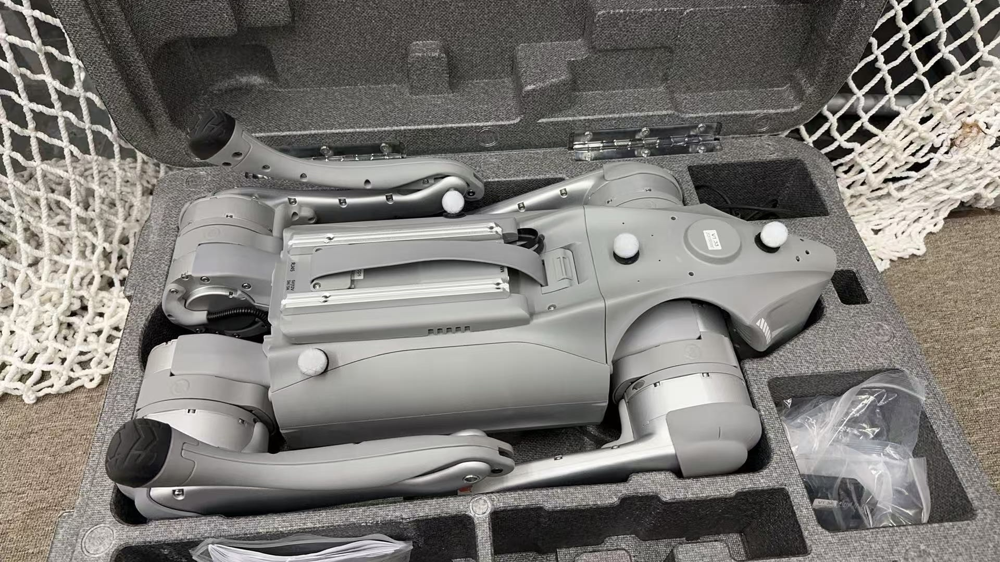

# Unitree Go2 动捕闭环无线轨迹追踪开发与操作手册

本文档记录基于 **NOKOV (XINGYING) 光学动捕系统 + 控制主机 (Ubuntu 20.04 / ROS 2 Foxy) + Unitree Go2 机载端** 实现无线闭环定点与圆周轨迹追踪的全流程配置、网络防抖动优化、三套实机控制脚本与联调步骤。
（后续若修改网络拓扑、更换动捕标定文件或调整控制增益，建议同步更新本文档）

> 注意：本流程所有 ROS 2 Foxy 依赖安装、编译（`colcon build`）与运行步骤均基于 **Ubuntu 20.04 原生系统 Python 环境（`/usr/bin/python3`，Python 3.8）**，严禁开启任何 Conda 虚拟环境（命令行前缀不得出现 `(base)` 等环境名），否则会导致编译报错或运行时找不到 `rclpy`。

# 目录

- [模块一：NOKOV动捕系统配置与VRPN推流](#模块一nokov动捕系统配置与vrpn推流)
- [模块二：三端网络拓扑与无线链路防抖动优化](#模块二三端网络拓扑与无线链路防抖动优化)
- [模块三：主机端环境搭建、VRPN驱动编译与话题验证](#模块三主机端环境搭建vrpn驱动编译与话题验证)
- [模块四：主机端三套闭环控制脚本部署](#模块四主机端三套闭环控制脚本部署)
- [模块五：Go2机载端UDP抗积压桥接部署](#模块五go2机载端udp抗积压桥接部署)
- [模块六：三端联调启动流程与常见故障排除](#模块六三端联调启动流程与常见故障排除)

---

# 模块一：NOKOV动捕系统配置与VRPN推流

本模块完成已有标定文件加载、Go2 机载刚体创建及 **XINGYING** 软件端 **VRPN** 实时广播配置，为控制主机提供约 `100 Hz` 的高频三维位姿反馈。

## 1 加载已有标定文件与连接镜头

### 1.1 直接加载场地标定文件（无需重复挥杆标定）

- 打开动捕电脑（Windows）上的 **XINGYING** 软件。
- 右下角点开C:\jk_for_nokov。
- 加载完成后，点击软件下方中部连接镜头按钮连接所有红外相机，等待 1～2 秒确认弹窗并检查所有镜头在线、画面无强反光干扰点。

> 注意：
> 1. 日常实验直接加载 **`C:\jk_for_nokov`** 中的已有标定文件即可，**不需要重复进行挥杆标定**；仅当场地镜头被物理碰动导致定位漂移时，才需要重新挥杆标定与 L 型架定原点。
> 2. XINGYING 输出数据遵循右手坐标系约定。正式闭环控制前，务必沿世界坐标系 $X/Y$ 轴手动搬动机器人，确认坐标增量正负号与预期一致。

### 1.2 Go2 刚体贴球与创建

- 在 Unitree Go2 机身顶部粘贴 4～5 颗反光标志球（Marker），遵守以下布局规范以防止特定偏航角下发生遮挡或共线丢点：

  - 采用 **非对称几何构型**，避免软件旋转解算歧义。
  - 在不同高度和平面分散布置（适当增加 1 颗高位或侧偏球），避免机器狗转向特定角度时反光球相互遮挡。
- 将 Go2 机头朝向世界坐标系 $+X$ 方向放置，在 **XINGYING** 中框选机身反光球(或者shift一个球一个球点)并右键创建刚体(rig)，命名为 **`go2`**（与后续 ROS 2 订阅话题 `/go2/pose` 严格对应）。

## 2 开启 VRPN 实时数据广播

### 2.1 VRPN 广播参数设置

- 在 **XINGYING** 软件顶部菜单打开数据广播设置（**Broadcast / VRPN Settings**），勾选启用 **VRPN** 广播并确认监听端口为默认 **`3883`** 。
- 确认软件当前处于 **实时捕捉模式（Live Mode）** 而非后处理模式（Post-process Mode）。

> 注意：
> 1. 后处理模式会阻塞实时客户端接收数据；若刚回放过录像，需先关闭客户端并切回实时模式。
> 2. Windows 端需确保防火墙允许 **XINGYING** 通信（或放行 TCP/UDP `3883` 端口），否则主机端 `vrpn_client_ros` 会一直卡在连接等待状态。
> 3. 当刚体发生遮挡或丢点时，动捕系统可能输出极大哨兵值（`9999999.000000`）或冻结上一帧位姿，控制端代码必须做哨兵值过滤（`LOST_SENTINEL = 9000000.0`）与超时保护。

---

# 模块二：三端网络拓扑与无线链路防抖动优化

本模块采用 **“三端同局域网 + 主机算控 + UDP 转发至 Go2 机载端”** 架构，重点消除无线网卡休眠、后台扫频漫游、DDS 组播抢带宽以及交换机环路引起的周期性卡顿。

## 1 网络拓扑与设备参数

### 1.1 设备 IP 与端口规划（统一接入 `Turbot3-Multi` 的 `192.168.169.x` 网段）

| 设备名称 | 系统与主机名 | IP 地址 | 关键接口/端口 | 职责说明 |
| --- | --- | --- | --- | --- |
| 网关路由器 | 5GHz Wi-Fi (`Turbot3-Multi`) | `192.168.169.1` | 5GHz 频段 | 三端无线局域网核心接入点 |
| 动捕电脑 | Windows 10 | `192.168.169.10` | VRPN 端口 `3883` | 运行 XINGYING，以约 `100 Hz` 广播 `go2` 刚体位姿 |
| 控制主机 | Ubuntu 20.04 (`cairen@foxy2004`) | `192.168.169.16` | 无线网卡 `wlo1` | 运行 `vrpn_client_ros` 与轨迹控制节点 |
| Go2 机载端 | Ubuntu 20.04 (`unitree@ubuntu`) | `192.168.169.17` | UDP 端口 `15001` | 运行 UDP 抗积压桥接，发布 `/api/sport/request` |

### 1.2 物理接线排查（防二层环路）

- 检查路由器与实验室绿联（UGREEN）交换机之间的网线连接 。

> 谨慎：在未开启生成树协议（STP）或链路聚合（LACP）时，**严禁在路由器与同一台交换机之间同时接入两根网线**（例如同时连接路由器的 `1` 口和 `2.5G` 口）。双线直连会形成二层网络环路，引发广播风暴与 MAC 地址表震荡，导致局域网出现间歇性高延迟与丢包。只保留单根线（优先保留 **`2.5G`** 端口网线）即可。（理论上是这样，但不知道为什么这个路由器插了两根线到交换机上都没事）

## 2 三端链路连通性测试

### 2.1 Ubuntu 主机端测试（Linux `ping`）

- 初次连网快速测通三端：

```bash
conda deactivate
ping -c 4 192.168.169.10    # 快速测试主机 -> 动捕电脑
ping -c 4 192.168.169.17    # 快速测试主机 -> Go2 机载端
```

- 稳定性压力测试（每 `0.2 s` 发包一次，检测是否存在周期性无线休眠尖峰）：

```bash
ping -c 25 -i 0.2 192.168.169.10    # 动捕电脑
ping -c 25 -i 0.2 192.168.169.1     # 网关路由器
ping -c 25 -i 0.2 192.168.169.17    # Go2 机载端
```

*备注1：Linux 普通用户限制 `-i` 最小发包间隔为 `0.2` 秒（`200 ms`），小于该值会报 `minimal interval allowed for user is 200ms`。*

- 正常链路应显示 `0% packet loss`，且平均延迟稳定在数十毫秒以内：

```text
25 packets transmitted, 25 received, 0% packet loss, time 4820ms
rtt min/avg/max/mdev = 4.653/15.420/38.120/7.510 ms
```

### 2.2 动捕电脑端反向测试（Windows `ping`）

- 在动捕电脑打开 **命令提示符（CMD）**，使用 `-n` 指定发包次数（**数字在前、IP 在后**）：

```cmd
ping -n 25 192.168.169.1
ping -n 25 192.168.169.16
ping -n 25 192.168.169.17
```

*备注1：如需持续监控，可将 `-n 25` 替换为 `-t`，随时按 `Ctrl+C` 终止并打印统计结果。*

## 3 无线链路抗卡顿与防休眠配置

### 3.1 主机端锁定 BSSID 并关闭 Wi-Fi 省电

为防止 Ubuntu 的 **NetworkManager** 周期性触发离信道扫描（off-channel scan）以及网卡进入省电休眠导致收发双向冻结，需在主机终端执行以下配置：

- 确认主机已连接至 5GHz 频段（`freq: 5xxx`）并锁定当前路由器 MAC 地址（BSSID）：

```bash
iw dev wlo1 link
CONN_NAME=$(nmcli -t -f NAME,DEVICE connection show --active | grep ':wlo1$' | cut -d: -f1)
CUR_BSSID=$(iw dev wlo1 link | awk '/Connected to/ {print $3}')
echo "锁定连接 [$CONN_NAME] -> BSSID [$CUR_BSSID]"
sudo nmcli connection modify "$CONN_NAME" 802-11-wireless.bssid "$CUR_BSSID"
sudo nmcli connection up "$CONN_NAME"
```

- 每次重连 Wi-Fi 或开机后关闭 `wlo1` 网卡省电模式，并核实输出 `Power save: off`：

```bash
sudo iw dev wlo1 set power_save off
iw dev wlo1 get power_save
```

### 3.2 主机端 ROS 2 通信隔离在本地回环（`lo`）

- 由于 `vrpn_client_ros` 与控制脚本均运行在同一台主机上，无需通过无线网卡广播 `100 Hz` 的 ROS 2 话题。启动主机端 ROS 2 节点前，统一通过 `CYCLONEDDS_URI` 将 DDS 通信锁死在本地回环网卡 `lo`：

```bash
export CYCLONEDDS_URI='<CycloneDDS><Domain><General><Interfaces><NetworkInterface name="lo"/></Interfaces></General></Domain></CycloneDDS>'
```

### 3.3 Go2 机载端防休眠保活

Go2 机载计算单元内部无线模块通常经网桥转接，在 Linux 侧执行 `iw dev` 可能无无线设备输出（无法直接通过 `iw` 关闭省电），容易周期性休眠约 2 秒导致控制包阶梯积压。

- 登录 Go2 机载端并挂载轻量后台网关保活进程：

```bash
ssh unitree@192.168.169.17    # 默认密码通常为 123
pgrep -af "ping -i 0.2 192.168.169.1" || nohup ping -i 0.2 192.168.169.1 > /dev/null 2>&1 &
```

---

# 模块三：主机端环境搭建、VRPN驱动编译与话题验证

本模块在 **Ubuntu 20.04 (ROS 2 Foxy)** 控制主机上完成网络基线检查、ROS 2 动捕依赖安装、NOKOV 官方 `vrpn_client_ros` 编译、动捕服务器 IP 写入以及 `/go2/pose` 话题频率与数据校验。

## 1 环境检查、依赖安装与 VRPN 驱动编译

### 1.1 第一步：确认环境与网络基线（切勿开 Conda）

> 虚拟环境提醒：安装 ROS 2 依赖和执行 `colcon build` 编译代码时，**不要开启任何 Conda 虚拟环境**！ROS 2 Foxy 依赖系统自带的 `/usr/bin/python3`（Python 3.8），开着 Conda 会导致编译报错或运行时找不到 `rclpy`。

打开终端，退出虚拟环境并检查防火墙与网卡 IP 状态：

```bash
# 1. 如果命令行前面有 (base) 或其他环境名，反复执行直到消失
conda deactivate
which python3    # 确认输出是 /usr/bin/python3

# 2. 关闭 Ubuntu 防火墙，避免拦截 VRPN (3883 端口) 和 UDP 数据
sudo ufw disable

# 3. 查看主机无线网卡 IP（通常是 wlo1，确认处于 192.168.169.x 网段）
ip -4 addr show
```

### 1.2 第二步：安装 ROS 2 Foxy 动捕依赖包

```bash
sudo apt update
sudo apt install -y \
  ros-foxy-vrpn \
  ros-foxy-geometry-msgs \
  ros-foxy-tf2 \
  ros-foxy-tf2-ros \
  ros-foxy-ament-cmake \
  ros-foxy-ament-lint-auto \
  ros-foxy-ament-lint-common \
  ros-foxy-rviz2
```

*备注1：如果 `ros-foxy-vrpn` 提示找不到包（部分 Foxy 镜像源可能缺失），先继续把后面几个依赖包安装完成，再通过 `vrpn` 源码编译补齐即可。*

### 1.3 第三步：克隆并编译 NOKOV 官方 ROS 2 动捕包

这里选用 NOKOV 官方专门适配 **Ubuntu 20.04 + ROS 2 Foxy** 的 `vrpn_client_ros` 仓库（支持位姿、速度、加速度话题；社区另一个 `vrpn_mocap` 新版本已放弃对 Foxy 的维护，不建议踩坑）。

> 虚拟环境提醒：`colcon build` 阶段绝对不要开虚拟环境。

```bash
conda deactivate 2>/dev/null || true    # 若前面有 (base) 等提示符则退出
source /opt/ros/foxy/setup.bash

mkdir -p ~/mocap_ws/src
cd ~/mocap_ws/src
git clone https://github.com/NOKOV-MOCAP/vrpn_client_ros.git

cd ~/mocap_ws
colcon build --symlink-install
```

### 1.4 第四步：本地编译结果自检

编译完成后加载工作空间，确认包已注册、查看默认参数文件，并确认 `rviz2` 可正常启动：

```bash
source /opt/ros/foxy/setup.bash
source ~/mocap_ws/install/setup.bash

# 1. 确认包已注册
ros2 pkg list | grep vrpn

# 2. 查看参数文件默认内容
cat ~/mocap_ws/src/vrpn_client_ros/config/sample.params.yaml

# 3. 确认 rviz2 能正常弹出窗口（弹出后直接关掉即可）
rviz2
```

## 2 修改动捕服务器 IP 并验证 `/go2/pose` 话题

### 2.1 测通网络、写入动捕电脑 IP 并启动 `vrpn_client_ros`

在 Ubuntu 20.04 主机终端保持未激活 Conda 状态，将动捕电脑 IP（`192.168.169.10`）写入 `sample.params.yaml` 并启动节点：

```bash
conda deactivate    # 确保命令行没有 (base) 等虚拟环境提示
ping -c 4 192.168.169.10

# 将动捕电脑 WLAN IP 写入 sample.params.yaml
sed -i "s/server: .*/server: 192.168.169.10/" ~/mocap_ws/src/vrpn_client_ros/config/sample.params.yaml
cat ~/mocap_ws/src/vrpn_client_ros/config/sample.params.yaml

# 隔离 DDS 至本地回环 lo 并启动 VRPN 节点
source /opt/ros/foxy/setup.bash
source ~/mocap_ws/install/setup.bash
export CYCLONEDDS_URI='<CycloneDDS><Domain><General><Interfaces><NetworkInterface name="lo"/></Interfaces></General></Domain></CycloneDDS>'
ros2 launch vrpn_client_ros sample.launch.py
```

成功识别到刚体 `go2` 后，终端会输出以下日志：

```text
[vrpn_client_node-1] [INFO] Connecting to VRPN server at 192.168.169.10:3883
[vrpn_client_node-1] [INFO] Connection established
[vrpn_client_node-1] [INFO] Found new sender: go2
[vrpn_client_node-1] [INFO] Creating new tracker go2
```

*备注1：终端可能出现 `VRPN Note: minor version number doesn't match ... This is not normally a problem.`，属于正常兼容提示，不影响位姿接收。*

### 2.2 新开主机终端查看 `/go2/pose` 话题列表、频率与实时位姿

保持前一个终端运行着 `vrpn_client_ros`，再开一个主机终端（同样**不要开 Conda**，且若前一个终端设置了 `CYCLONEDDS_URI` 绑定 `lo`，此终端也需设置相同环境变量）：

```bash
conda deactivate
source /opt/ros/foxy/setup.bash
source ~/mocap_ws/install/setup.bash
export CYCLONEDDS_URI='<CycloneDDS><Domain><General><Interfaces><NetworkInterface name="lo"/></Interfaces></General></Domain></CycloneDDS>'

# 1. 查看当前在线话题（应能看到 /go2/pose）
ros2 topic list

# 2. 检查动捕位姿发布频率（正常约 100 Hz，查看后按 Ctrl+C 退出）
ros2 topic hz /go2/pose

# 3. 打印一帧实时位姿数据，核对 position(x, y, z) 与 orientation(x, y, z, w)
ros2 topic echo /go2/pose --once
```

确认主机已稳定收到约 `100 Hz` 的 `/go2/pose` 数据后，即可测试主机到 Go2（`192.168.169.17`）的连通性并进入控制部署阶段：

```bash
conda deactivate
ping -c 4 192.168.169.17
```

---

# 模块四：主机端三套闭环控制脚本部署

目前 `~/mocap_ws/` 目录下维护了三套循序渐进的闭环控制脚本，分别面向 **单点链路验证**、**基础圆周追踪** 与 **PID 增强圆周追踪**。

## 1 控制脚本概览与参数演进

| 脚本文件 | 适用场景 | 发送频率 | 核心控制算法与关键参数 |
| --- | --- | --- | --- |
| `go2_mocap_udp_ctrl.py` | 全链路联调与单点定点验证 | `30 Hz` | 机头正前方 $0.3\text{ m}$ 定点比例控制；含起步死区补偿 `min_v_xy = 0.23`、到点容差 `0.05 m`、`0.3 s` 断流急停 |
| `go2_mocap_circle_ctrl.py` | 持续圆周走圈（稳定演示版） | `10 Hz` | 半径 `R = 0.90 m`、`v_ref = 0.38 m/s`；曲率前馈 `ff_gain = 1.15` + 径向引导 `kr_radial = 1.2` + 航向比例 `kyaw = 1.1` + 盲区滑行（`0.25 s ~ 30.0 s`） |
| `go2_mocap_circle_pid_ctrl.py` | 持续圆周走圈（PID 抗稳态偏差版） | `10 Hz` | 在圆周前馈与径向引导基础上，将航向纠偏升级为完整 PID（`kp_yaw = 1.10`, `ki_yaw = 0.15`, `kd_yaw = 0.12`），带积分抗饱和限幅 `i_lim_yaw = 0.60`、一阶低通微分滤波 `d_tau = 0.15` 及盲区恢复防微分冲击机制 |

### 圆周控制律与实测调优记录

Go2 高层运控（Sport Mode）存在约 $0.22\text{ m/s}$ 的起步步态死区。圆周控制器在收到首帧有效位姿后，自动将圆心锁定在机器人左侧垂直距离 $R$ 处，利用曲率前馈结合径向/航向误差反馈生成偏航角速度指令：

$$\omega_{ff} = k_{ff} \cdot \frac{v_{\text{ref}}}{R}$$

$$\psi_{\text{des}} = \text{wrap}\left(\theta + \frac{\pi}{2} + \text{atan2}(k_r \cdot e_r,\; v_{\text{ref}})\right)$$

其中 $e_r = r_{\text{curr}} - R$ 为径向误差，$\theta$ 为当前极角。实测参数演进对照如下：

| 调优阶段 | 半径 `radius` | 线速度 `v_ref` | 发送频率 `send_hz` | 角速度上限 `max_vyaw` | 实机表现 |
| --- | --- | --- | --- | --- | --- |
| 初版验证 | `0.65 m` | `0.27 m/s` | `15 Hz` | `0.85 rad/s` | 径向误差 $3\text{--}6\text{ cm}$，偶受无线积压影响 |
| 降频稳态版 | `0.75 m` | `0.30 m/s` | `10 Hz` | `0.85 rad/s` | 步态明显更稳，无线负载降低 |
| 流畅演示版（当前默认） | `0.90 m` | `0.38 m/s` | `10 Hz` | `1.00 rad/s` | 圆弧舒展、步态连贯，适合持续走圈拍摄 |

## 2 完整控制脚本代码

### 2.1 单点定点验证脚本：`~/mocap_ws/go2_mocap_udp_ctrl.py`

用于首次打通链路后验证坐标系方向、起步死区补偿与 UDP 控制通路是否正常：

```python
#!/usr/bin/env python3
import json
import math
import socket
import time
import rclpy
from rclpy.node import Node
from rclpy.qos import QoSProfile, ReliabilityPolicy, HistoryPolicy
from geometry_msgs.msg import PoseStamped

API_ID_STOPMOVE = 1003
API_ID_MOVE = 1008
LOST_SENTINEL = 9000000.0


def wrap_angle(angle: float) -> float:
    return math.atan2(math.sin(angle), math.cos(angle))


def quat_to_yaw(qx: float, qy: float, qz: float, qw: float) -> float:
    siny_cosp = 2.0 * (qw * qz + qx * qy)
    cosy_cosp = 1.0 - 2.0 * (qy * qy + qz * qz)
    return math.atan2(siny_cosp, cosy_cosp)


def clamp(v: float, lim: float) -> float:
    return max(-lim, min(lim, v))


class Go2MocapUdpCtrl(Node):
    def __init__(self):
        super().__init__("go2_mocap_udp_ctrl")
        self.declare_parameter("mocap_topic", "/go2/pose")
        self.declare_parameter("go2_ip", "192.168.169.17")
        self.declare_parameter("go2_port", 15001)
        self.declare_parameter("send_udp", True)

        topic = self.get_parameter("mocap_topic").value
        go2_ip = self.get_parameter("go2_ip").value
        go2_port = int(self.get_parameter("go2_port").value)
        self.send_udp = self.get_parameter("send_udp").value
        self.target = (go2_ip, go2_port)

        self.target_xy = None
        self.target_yaw = None
        self.curr_pose = None
        self.last_msg_t = None
        self.last_print_t = 0.0

        self.kp_xy = 0.8
        self.kp_yaw = 0.8
        self.max_vx = 0.30
        self.max_vy = 0.15
        self.max_vyaw = 0.40
        self.min_v_xy = 0.23   # 跨过 Go2 Sport 模式约 0.10 m/s 的起步死区
        self.pos_tol = 0.05    # 到点位置容差 (m)
        self.yaw_tol = math.radians(3.0)

        qos = QoSProfile(
            reliability=ReliabilityPolicy.BEST_EFFORT,
            history=HistoryPolicy.KEEP_LAST,
            depth=10,
        )
        self.sub = self.create_subscription(PoseStamped, topic, self.pose_cb, qos)
        self.sock = socket.socket(socket.AF_INET, socket.SOCK_DGRAM)
        self.timer = self.create_timer(1.0 / 30.0, self.loop)
        self.get_logger().info(f"订阅 {topic} -> UDP 目标 {self.target} | send_udp={self.send_udp}")

    def pose_cb(self, msg: PoseStamped):
        p = msg.pose.position
        q = msg.pose.orientation
        vals = [p.x, p.y, p.z, q.x, q.y, q.z, q.w]
        if any(math.isnan(v) or math.isinf(v) for v in vals):
            return
        if abs(p.x) > LOST_SENTINEL or abs(p.y) > LOST_SENTINEL or abs(p.z) > LOST_SENTINEL:
            return

        yaw = quat_to_yaw(q.x, q.y, q.z, q.w)
        self.curr_pose = (p.x, p.y, p.z, yaw)
        self.last_msg_t = time.monotonic()

        if self.target_xy is None:
            # 以启动瞬间位置为基准，设置机头正前方 0.3 m 为目标点
            self.target_xy = (p.x + 0.3 * math.cos(yaw), p.y + 0.3 * math.sin(yaw))
            self.target_yaw = yaw
            self.get_logger().info(
                f"初始位姿: ({p.x:.3f}, {p.y:.3f}) -> 目标点: ({self.target_xy[0]:.3f}, {self.target_xy[1]:.3f}), yaw={math.degrees(yaw):.1f}°"
            )

    def send_cmd(self, api_id: int, param: dict):
        if not self.send_udp:
            return
        pkt = json.dumps({"api_id": api_id, "parameter": param}).encode("utf-8")
        self.sock.sendto(pkt, self.target)

    def loop(self):
        if self.curr_pose is None or self.last_msg_t is None:
            return
        now = time.monotonic()
        if now - self.last_msg_t > 0.3:
            self.get_logger().warn("动捕断流 > 0.3s，发送 StopMove", throttle_duration_sec=1.0)
            self.send_cmd(API_ID_STOPMOVE, {})
            return

        x, y, _, yaw = self.curr_pose
        ex_w = self.target_xy[0] - x
        ey_w = self.target_xy[1] - y
        pos_err = math.hypot(ex_w, ey_w)
        eyaw = wrap_angle(self.target_yaw - yaw)

        if pos_err < self.pos_tol:
            vx_b, vy_b = 0.0, 0.0
        else:
            vx_w = self.kp_xy * ex_w
            vy_w = self.kp_xy * ey_w
            c, s = math.cos(yaw), math.sin(yaw)
            vx_b = c * vx_w + s * vy_w
            vy_b = -s * vx_w + c * vy_w

            v_norm = math.hypot(vx_b, vy_b)
            if 1e-4 < v_norm < self.min_v_xy:
                scale = self.min_v_xy / v_norm
                vx_b *= scale
                vy_b *= scale

            vx_b = clamp(vx_b, self.max_vx)
            vy_b = clamp(vy_b, self.max_vy)

        if abs(eyaw) < self.yaw_tol:
            vyaw = 0.0
        else:
            vyaw = clamp(self.kp_yaw * eyaw, self.max_vyaw)

        self.send_cmd(API_ID_MOVE, {"x": round(vx_b, 4), "y": round(vy_b, 4), "z": round(vyaw, 4)})

        if now - self.last_print_t > 0.1:
            self.last_print_t = now
            self.get_logger().info(
                f"err={pos_err:.3f}m | pose=({x:.2f},{y:.2f},{math.degrees(yaw):.0f}°) | cmd=(vx={vx_b:.2f}, vy={vy_b:.2f}, vyaw={vyaw:.2f})"
            )


def main():
    rclpy.init()
    node = Go2MocapUdpCtrl()
    try:
        rclpy.spin(node)
    except KeyboardInterrupt:
        pass
    finally:
        node.send_cmd(API_ID_STOPMOVE, {})
        node.destroy_node()
        rclpy.shutdown()


if __name__ == "__main__":
    main()
```

### 2.2 圆周追踪基础版（前馈 + P 纠偏）：`~/mocap_ws/go2_mocap_circle_ctrl.py`

实机验证流畅度最好的基础持续走圈版本：

```python
#!/usr/bin/env python3
import json
import math
import socket
import time
import rclpy
from rclpy.node import Node
from rclpy.qos import QoSProfile, ReliabilityPolicy, HistoryPolicy
from geometry_msgs.msg import PoseStamped

API_ID_STOPMOVE = 1003
API_ID_MOVE = 1008
LOST_SENTINEL = 9000000.0


def wrap_angle(angle: float) -> float:
    return math.atan2(math.sin(angle), math.cos(angle))


def quat_to_yaw(qx: float, qy: float, qz: float, qw: float) -> float:
    siny_cosp = 2.0 * (qw * qz + qx * qy)
    cosy_cosp = 1.0 - 2.0 * (qy * qy + qz * qz)
    return math.atan2(siny_cosp, cosy_cosp)


def clamp(v: float, lim: float) -> float:
    return max(-lim, min(lim, v))


class Go2MocapCircleCtrl(Node):
    def __init__(self):
        super().__init__("go2_mocap_circle_ctrl")
        self.declare_parameter("mocap_topic", "/go2/pose")
        self.declare_parameter("go2_ip", "192.168.169.17")
        self.declare_parameter("go2_port", 15001)
        self.declare_parameter("radius", 0.90)         # 更大圆半径 (m)
        self.declare_parameter("v_ref", 0.38)          # 更快前向速度 (m/s)
        self.declare_parameter("send_hz", 10.0)
        self.declare_parameter("ff_gain", 1.15)
        self.declare_parameter("kr_radial", 1.2)
        self.declare_parameter("kyaw", 1.1)
        self.declare_parameter("laps", 100.0)

        topic = self.get_parameter("mocap_topic").value
        go2_ip = self.get_parameter("go2_ip").value
        go2_port = int(self.get_parameter("go2_port").value)
        self.R = float(self.get_parameter("radius").value)
        self.v_ref = float(self.get_parameter("v_ref").value)
        self.send_hz = float(self.get_parameter("send_hz").value)
        self.ff_gain = float(self.get_parameter("ff_gain").value)
        self.kr_radial = float(self.get_parameter("kr_radial").value)
        self.kyaw = float(self.get_parameter("kyaw").value)
        self.laps = float(self.get_parameter("laps").value)
        self.target = (go2_ip, go2_port)

        self.center_xy = None
        self.prev_theta = None
        self.accum_angle = 0.0
        self.start_t = None
        self.finished = False

        self.curr_pose = None
        self.last_msg_t = None
        self.last_pose_change_t = None
        self.last_print_t = 0.0
        self.max_vyaw = 1.0

        qos = QoSProfile(
            reliability=ReliabilityPolicy.BEST_EFFORT,
            history=HistoryPolicy.KEEP_LAST,
            depth=10,
        )
        self.sub = self.create_subscription(PoseStamped, topic, self.pose_cb, qos)
        self.sock = socket.socket(socket.AF_INET, socket.SOCK_DGRAM)
        self.timer = self.create_timer(1.0 / self.send_hz, self.loop)
        w_ff = self.ff_gain * (self.v_ref / self.R)
        self.get_logger().info(
            f"圆周控制就绪: R={self.R:.2f}m, vx={self.v_ref:.2f}m/s, w_ff={w_ff:.2f}rad/s, rate={self.send_hz:.0f}Hz"
        )

    def pose_cb(self, msg: PoseStamped):
        p = msg.pose.position
        q = msg.pose.orientation
        vals = [p.x, p.y, p.z, q.x, q.y, q.z, q.w]
        if any(math.isnan(v) or math.isinf(v) for v in vals):
            return
        if abs(p.x) > LOST_SENTINEL or abs(p.y) > LOST_SENTINEL or abs(p.z) > LOST_SENTINEL:
            return

        now = time.monotonic()
        yaw = quat_to_yaw(q.x, q.y, q.z, q.w)
        new_pose = (p.x, p.y, p.z, yaw)

        if self.curr_pose is None or any(abs(a - b) > 1e-6 for a, b in zip(new_pose, self.curr_pose)):
            self.last_pose_change_t = now

        self.curr_pose = new_pose
        self.last_msg_t = now

        if self.center_xy is None:
            cx = p.x - self.R * math.sin(yaw)
            cy = p.y + self.R * math.cos(yaw)
            self.center_xy = (cx, cy)
            self.prev_theta = math.atan2(p.y - cy, p.x - cx)
            self.start_t = now
            self.get_logger().info(
                f"起点锁定: ({p.x:.2f}, {p.y:.2f}, {math.degrees(yaw):.0f}°) | 圆心: ({cx:.2f}, {cy:.2f})"
            )

    def send_cmd(self, api_id: int, param: dict):
        pkt = json.dumps({"api_id": api_id, "parameter": param}).encode("utf-8")
        self.sock.sendto(pkt, self.target)

    def loop(self):
        if self.curr_pose is None or self.last_msg_t is None or self.start_t is None:
            return

        if self.finished:
            self.send_cmd(API_ID_MOVE, {"x": 0.0, "y": 0.0, "z": 0.0})
            return

        now = time.monotonic()
        stale_dt = max(now - self.last_msg_t, now - self.last_pose_change_t)

        if stale_dt > 30.0:
            self.get_logger().warn("动捕断流/丢点 > 30.0s，发送 StopMove", throttle_duration_sec=1.0)
            self.send_cmd(API_ID_STOPMOVE, {})
            return

        omega_ff = self.ff_gain * (self.v_ref / self.R)

        if stale_dt > 0.25:
            vyaw = clamp(omega_ff, self.max_vyaw)
            self.send_cmd(API_ID_MOVE, {"x": round(self.v_ref, 4), "y": 0.0, "z": round(vyaw, 4)})
            if now - self.last_print_t > 0.25:
                self.last_print_t = now
                self.get_logger().info(
                    f"[盲区滑行 {stale_dt:.2f}s] cmd=(vx={self.v_ref:.2f}, vyaw={vyaw:.2f})"
                )
            return

        x, y, _, yaw = self.curr_pose
        cx, cy = self.center_xy
        dx, dy = x - cx, y - cy
        r_curr = math.hypot(dx, dy)
        theta_curr = math.atan2(dy, dx)

        dtheta = wrap_angle(theta_curr - self.prev_theta)
        self.accum_angle += dtheta
        self.prev_theta = theta_curr

        target_angle = 2.0 * math.pi * self.laps
        if (now - self.start_t > 3.0) and (self.accum_angle >= target_angle - 0.04):
            self.finished = True
            self.send_cmd(API_ID_MOVE, {"x": 0.0, "y": 0.0, "z": 0.0})
            self.get_logger().info(
                f"圆周完成 ({math.degrees(self.accum_angle):.0f}°)！停稳位姿=({x:.2f}, {y:.2f}, {math.degrees(yaw):.0f}°)"
            )
            return

        radial_err = r_curr - self.R
        tangent_yaw = theta_curr + math.pi / 2.0
        radial_steer = math.atan2(self.kr_radial * radial_err, self.v_ref)
        desired_yaw = wrap_angle(tangent_yaw + radial_steer)

        eyaw = wrap_angle(desired_yaw - yaw)
        vyaw = clamp(omega_ff + self.kyaw * eyaw, self.max_vyaw)
        vyaw = max(0.24, vyaw)

        self.send_cmd(API_ID_MOVE, {"x": round(self.v_ref, 4), "y": 0.0, "z": round(vyaw, 4)})

        if now - self.last_print_t > 0.25:
            self.last_print_t = now
            deg_done = math.degrees(self.accum_angle)
            self.get_logger().info(
                f"[{deg_done:5.1f}°] r_err={radial_err:+.3f}m | pose=({x:.2f},{y:.2f},{math.degrees(yaw):.0f}°) | "
                f"cmd=(vx={self.v_ref:.2f}, vyaw={vyaw:.2f})"
            )


def main():
    rclpy.init()
    node = Go2MocapCircleCtrl()
    try:
        rclpy.spin(node)
    except KeyboardInterrupt:
        pass
    finally:
        node.send_cmd(API_ID_STOPMOVE, {})
        node.destroy_node()
        rclpy.shutdown()


if __name__ == "__main__":
    main()
```

### 2.3 圆周追踪 PID 增强版：`~/mocap_ws/go2_mocap_circle_pid_ctrl.py`

在基础圆周追踪之上引入航向 **PID 反馈控制**（含积分抗饱和限幅 `i_lim_yaw`、一阶低通滤波微分项 `d_tau`，且盲区滑行期间自动清空 `prev_eyaw` 防止出盲区瞬间产生微分冲击），用于进一步消除稳态航向与径向偏差：

```python
#!/usr/bin/env python3
import json
import math
import socket
import time
import rclpy
from rclpy.node import Node
from rclpy.qos import QoSProfile, ReliabilityPolicy, HistoryPolicy
from geometry_msgs.msg import PoseStamped

API_ID_STOPMOVE = 1003
API_ID_MOVE = 1008
LOST_SENTINEL = 9000000.0


def wrap_angle(angle: float) -> float:
    return math.atan2(math.sin(angle), math.cos(angle))


def quat_to_yaw(qx: float, qy: float, qz: float, qw: float) -> float:
    siny_cosp = 2.0 * (qw * qz + qx * qy)
    cosy_cosp = 1.0 - 2.0 * (qy * qy + qz * qz)
    return math.atan2(siny_cosp, cosy_cosp)


def clamp(v: float, lo: float, hi: float) -> float:
    return max(lo, min(hi, v))


class Go2MocapCirclePidCtrl(Node):
    def __init__(self):
        super().__init__("go2_mocap_circle_pid_ctrl")
        self.declare_parameter("mocap_topic", "/go2/pose")
        self.declare_parameter("go2_ip", "192.168.169.17")
        self.declare_parameter("go2_port", 15001)
        self.declare_parameter("radius", 0.90)
        self.declare_parameter("v_ref", 0.38)
        self.declare_parameter("send_hz", 10.0)
        self.declare_parameter("ff_gain", 1.15)
        self.declare_parameter("kr_radial", 1.20)
        self.declare_parameter("kp_yaw", 1.10)
        self.declare_parameter("ki_yaw", 0.15)
        self.declare_parameter("kd_yaw", 0.12)
        self.declare_parameter("i_lim_yaw", 0.60)
        self.declare_parameter("d_tau", 0.15)
        self.declare_parameter("laps", 100.0)

        topic = self.get_parameter("mocap_topic").value
        go2_ip = self.get_parameter("go2_ip").value
        go2_port = int(self.get_parameter("go2_port").value)
        self.R = float(self.get_parameter("radius").value)
        self.v_ref = float(self.get_parameter("v_ref").value)
        self.send_hz = float(self.get_parameter("send_hz").value)
        self.ff_gain = float(self.get_parameter("ff_gain").value)
        self.kr_radial = float(self.get_parameter("kr_radial").value)
        self.kp_yaw = float(self.get_parameter("kp_yaw").value)
        self.ki_yaw = float(self.get_parameter("ki_yaw").value)
        self.kd_yaw = float(self.get_parameter("kd_yaw").value)
        self.i_lim_yaw = float(self.get_parameter("i_lim_yaw").value)
        self.d_tau = max(0.01, float(self.get_parameter("d_tau").value))
        self.laps = float(self.get_parameter("laps").value)
        self.target = (go2_ip, go2_port)

        self.center_xy = None
        self.prev_theta = None
        self.accum_angle = 0.0
        self.start_t = None
        self.finished = False

        self.curr_pose = None
        self.last_msg_t = None
        self.last_pose_change_t = None
        self.last_loop_t = None
        self.last_print_t = 0.0
        self.max_vyaw = 1.0

        self.yaw_integral = 0.0
        self.prev_eyaw = None
        self.deyaw_filt = 0.0

        qos = QoSProfile(
            reliability=ReliabilityPolicy.BEST_EFFORT,
            history=HistoryPolicy.KEEP_LAST,
            depth=10,
        )
        self.sub = self.create_subscription(PoseStamped, topic, self.pose_cb, qos)
        self.sock = socket.socket(socket.AF_INET, socket.SOCK_DGRAM)
        self.timer = self.create_timer(1.0 / self.send_hz, self.loop)
        w_ff = self.ff_gain * (self.v_ref / self.R)
        self.get_logger().info(
            f"[新文件 PID 版] R={self.R:.2f}m, vx={self.v_ref:.2f}m/s, w_ff={w_ff:.2f}rad/s, "
            f"PID=({self.kp_yaw:.2f}, {self.ki_yaw:.2f}, {self.kd_yaw:.2f}), rate={self.send_hz:.0f}Hz"
        )

    def pose_cb(self, msg: PoseStamped):
        p = msg.pose.position
        q = msg.pose.orientation
        vals = [p.x, p.y, p.z, q.x, q.y, q.z, q.w]
        if any(math.isnan(v) or math.isinf(v) for v in vals):
            return
        if abs(p.x) > LOST_SENTINEL or abs(p.y) > LOST_SENTINEL or abs(p.z) > LOST_SENTINEL:
            return

        now = time.monotonic()
        yaw = quat_to_yaw(q.x, q.y, q.z, q.w)
        new_pose = (p.x, p.y, p.z, yaw)

        if self.curr_pose is None or any(abs(a - b) > 1e-6 for a, b in zip(new_pose, self.curr_pose)):
            self.last_pose_change_t = now

        self.curr_pose = new_pose
        self.last_msg_t = now

        if self.center_xy is None:
            cx = p.x - self.R * math.sin(yaw)
            cy = p.y + self.R * math.cos(yaw)
            self.center_xy = (cx, cy)
            self.prev_theta = math.atan2(p.y - cy, p.x - cx)
            self.start_t = now
            self.last_loop_t = now
            self.get_logger().info(
                f"起点锁定: ({p.x:.2f}, {p.y:.2f}, {math.degrees(yaw):.0f}°) | 圆心: ({cx:.2f}, {cy:.2f})"
            )

    def send_cmd(self, api_id: int, param: dict):
        pkt = json.dumps({"api_id": api_id, "parameter": param}).encode("utf-8")
        self.sock.sendto(pkt, self.target)

    def loop(self):
        if self.curr_pose is None or self.last_msg_t is None or self.start_t is None:
            return

        now = time.monotonic()
        dt = 1.0 / self.send_hz if self.last_loop_t is None else clamp(now - self.last_loop_t, 0.01, 0.5)
        self.last_loop_t = now

        if self.finished:
            self.send_cmd(API_ID_MOVE, {"x": 0.0, "y": 0.0, "z": 0.0})
            return

        stale_dt = max(now - self.last_msg_t, now - self.last_pose_change_t)

        if stale_dt > 30.0:
            self.get_logger().warn("动捕断流/丢点 > 30.0s，发送 StopMove", throttle_duration_sec=1.0)
            self.send_cmd(API_ID_STOPMOVE, {})
            return

        omega_ff = self.ff_gain * (self.v_ref / self.R)

        if stale_dt > 0.25:
            self.prev_eyaw = None
            vyaw = clamp(omega_ff, -self.max_vyaw, self.max_vyaw)
            self.send_cmd(API_ID_MOVE, {"x": round(self.v_ref, 4), "y": 0.0, "z": round(vyaw, 4)})
            if now - self.last_print_t > 0.25:
                self.last_print_t = now
                self.get_logger().info(
                    f"[盲区滑行 {stale_dt:.2f}s] cmd=(vx={self.v_ref:.2f}, vyaw={vyaw:.2f})"
                )
            return

        x, y, _, yaw = self.curr_pose
        cx, cy = self.center_xy
        dx, dy = x - cx, y - cy
        r_curr = math.hypot(dx, dy)
        theta_curr = math.atan2(dy, dx)

        dtheta = wrap_angle(theta_curr - self.prev_theta)
        self.accum_angle += dtheta
        self.prev_theta = theta_curr

        target_angle = 2.0 * math.pi * self.laps
        if (now - self.start_t > 3.0) and (self.accum_angle >= target_angle - 0.04):
            self.finished = True
            self.send_cmd(API_ID_MOVE, {"x": 0.0, "y": 0.0, "z": 0.0})
            self.get_logger().info(
                f"圆周完成 ({math.degrees(self.accum_angle):.0f}°)！停稳位姿=({x:.2f}, {y:.2f}, {math.degrees(yaw):.0f}°)"
            )
            return

        radial_err = r_curr - self.R
        tangent_yaw = theta_curr + math.pi / 2.0
        radial_steer = math.atan2(self.kr_radial * radial_err, self.v_ref)
        desired_yaw = wrap_angle(tangent_yaw + radial_steer)

        eyaw = wrap_angle(desired_yaw - yaw)
        self.yaw_integral = clamp(self.yaw_integral + eyaw * dt, -self.i_lim_yaw, self.i_lim_yaw)

        if self.prev_eyaw is None:
            raw_deyaw = 0.0
        else:
            raw_deyaw = wrap_angle(eyaw - self.prev_eyaw) / dt
        self.prev_eyaw = eyaw
        alpha = dt / (self.d_tau + dt)
        self.deyaw_filt = (1.0 - alpha) * self.deyaw_filt + alpha * raw_deyaw

        u_pid = (
            self.kp_yaw * eyaw
            + self.ki_yaw * self.yaw_integral
            + self.kd_yaw * self.deyaw_filt
        )
        vyaw = clamp(omega_ff + u_pid, -self.max_vyaw, self.max_vyaw)
        vyaw = max(0.24, vyaw)

        self.send_cmd(API_ID_MOVE, {"x": round(self.v_ref, 4), "y": 0.0, "z": round(vyaw, 4)})

        if now - self.last_print_t > 0.25:
            self.last_print_t = now
            deg_done = math.degrees(self.accum_angle)
            self.get_logger().info(
                f"[{deg_done:5.1f}°] r_err={radial_err:+.3f}m | eyaw={math.degrees(eyaw):+5.1f}° | "
                f"i_term={self.ki_yaw * self.yaw_integral:+.2f} | cmd=(vx={self.v_ref:.2f}, vyaw={vyaw:.2f})"
            )


def main():
    rclpy.init()
    node = Go2MocapCirclePidCtrl()
    try:
        rclpy.spin(node)
    except KeyboardInterrupt:
        pass
    finally:
        node.send_cmd(API_ID_STOPMOVE, {})
        node.destroy_node()
        rclpy.shutdown()


if __name__ == "__main__":
    main()
```

*备注1：正式实验若需严格跑完 1 圈自动停稳，可在启动时通过 ROS 2 参数覆盖 `--ros-args -p laps:=1.0`，或将脚本内超时停机阈值从 `30.0` 调回 `1.5`。*

---

# 模块五：Go2机载端UDP抗积压桥接部署

本模块在 Go2 机载 Ubuntu 端建立 UDP 到 ROS 2 `/api/sport/request` 话题的轻量桥接节点，采用非阻塞读空缓冲区机制（每周期丢弃积压旧包、仅转发最新一帧），避免无线瞬时抖动后出现“陈旧速度指令延时回放”。

## 1 Go2 机载端环境说明

- 通过 SSH 登录 Go2 机载端（登录提示 `ros:foxy(1) noetic(2) ?` 时输入 **`1`** 选择 ROS 2 Foxy）：

```bash
ssh unitree@192.168.169.17
```

- 确认机载开发目录 `~/zjjgo2` 下已包含 `unitree_ros2` 环境初始化脚本 `~/zjjgo2/run.sh`（负责加载 `unitree_api` 消息包与内网 DDS 网卡配置）。

## 2 抗积压桥接脚本：`~/zjjgo2/mocap_udp_bridge.py`

```python
#!/usr/bin/env python3
import json
import socket
import time
import rclpy
from rclpy.node import Node
from unitree_api.msg import Request

UDP_IP = "0.0.0.0"
UDP_PORT = 15001
FORWARD_TO_SPORT = True


class MocapUdpBridge(Node):
    def __init__(self):
        super().__init__("mocap_udp_bridge")
        self.pub = self.create_publisher(Request, "/api/sport/request", 10)

        self.sock = socket.socket(socket.AF_INET, socket.SOCK_DGRAM)
        self.sock.bind((UDP_IP, UDP_PORT))
        self.sock.setblocking(False)

        self.rx_count = 0
        self.last_log_t = 0.0
        self.timer = self.create_timer(0.01, self.poll_udp)
        self.get_logger().info(
            f"监听 UDP {UDP_IP}:{UDP_PORT} | FORWARD_TO_SPORT={FORWARD_TO_SPORT} | 抗积压模式"
        )

    def poll_udp(self):
        latest_data = None
        latest_addr = None
        dropped = 0

        # 循环读空 socket 接收缓冲区，仅保留最新一帧指令
        while True:
            try:
                data, addr = self.sock.recvfrom(4096)
                if latest_data is not None:
                    dropped += 1
                latest_data = data
                latest_addr = addr
                self.rx_count += 1
            except BlockingIOError:
                break

        if latest_data is None:
            return

        try:
            payload = json.loads(latest_data.decode("utf-8"))
            api_id = int(payload["api_id"])
            param = payload.get("parameter", {})
        except Exception as exc:
            self.get_logger().warn(f"UDP JSON 解析失败: {exc}")
            return

        if FORWARD_TO_SPORT:
            req = Request()
            req.header.identity.id = int(time.time() * 1e6)
            req.header.identity.api_id = api_id
            req.parameter = json.dumps(param) if param else ""
            self.pub.publish(req)

        now = time.monotonic()
        if dropped > 0 or (now - self.last_log_t > 0.5):
            self.last_log_t = now
            self.get_logger().info(
                f"[rx={self.rx_count}, 丢弃旧包={dropped}] 来自 {latest_addr}: api_id={api_id}, param={param}"
            )


def main():
    rclpy.init()
    node = MocapUdpBridge()
    try:
        rclpy.spin(node)
    except KeyboardInterrupt:
        pass
    finally:
        node.sock.close()
        node.destroy_node()
        rclpy.shutdown()


if __name__ == "__main__":
    main()
```

*备注1：Unitree Go2 Sport API 常用指令编号：`1003` 为 `StopMove`（停止移动），`1008` 为 `Move`（速度控制，参数格式 `{"x": vx, "y": vy, "z": vyaw}`）。*

---

# 模块六：三端联调启动流程与常见故障排除

本模块给出实机运行的标准启动顺序及实验过程中典型问题的快速排查方法。

## 1 标准实机启动顺序

> 谨慎：启动前务必确认 Go2 左侧与前方留有 **直径 $2.0\text{ m}$ 以上** 的无障碍空地；用官方遥控器先让 Go2 处于 **常规站立/行走状态**，且 **全程将遥控器握在手中**，随时准备手动接管急停。

### 1.1 第 1 步：动捕电脑（Windows）

- 启动 **XINGYING**，加载 **`C:\jk_for_nokov`** 中的场地标定文件并连接镜头，确认画面稳定、刚体 `go2` 追踪无闪烁、VRPN 广播（`3883`）已开启。

### 1.2 第 2 步：Go2 机载端（`unitree@ubuntu`）

- 挂载后台防休眠保活并启动 UDP 桥接脚本（保持原生系统环境）：

```bash
pgrep -af "ping -i 0.2 192.168.169.1" || nohup ping -i 0.2 192.168.169.1 > /dev/null 2>&1 &
source /opt/ros/foxy/setup.bash
source ~/zjjgo2/run.sh
python3 ~/zjjgo2/mocap_udp_bridge.py
```

- 启动成功终端显示：

```text
[INFO] [mocap_udp_bridge]: 监听 UDP 0.0.0.0:15001 | FORWARD_TO_SPORT=True | 抗积压模式
```

### 1.3 第 3 步：主机终端 1（`cairen@foxy2004`）启动动捕接收

- 确认退出 Conda、关闭无线省电并隔离 CycloneDDS 至本地回环 `lo`：

```bash
conda deactivate 2>/dev/null || true
sudo iw dev wlo1 set power_save off
source /opt/ros/foxy/setup.bash
source ~/mocap_ws/install/setup.bash
export CYCLONEDDS_URI='<CycloneDDS><Domain><General><Interfaces><NetworkInterface name="lo"/></Interfaces></General></Domain></CycloneDDS>'
ros2 launch vrpn_client_ros sample.launch.py
```

### 1.4 第 4 步：主机终端 2（`cairen@foxy2004`）按需启动对应控制脚本

- 确认终端 1 已正常创建 `tracker go2` 后，按需求三选一启动：

```bash
conda deactivate 2>/dev/null || true
source /opt/ros/foxy/setup.bash
export CYCLONEDDS_URI='<CycloneDDS><Domain><General><Interfaces><NetworkInterface name="lo"/></Interfaces></General></Domain></CycloneDDS>'

# 方案 A：单点闭环验证（前进 0.3 m）
python3 ~/mocap_ws/go2_mocap_udp_ctrl.py

# 方案 B：圆周追踪基础版（前馈 + P 纠偏，R=0.90m, vx=0.38m/s）
python3 ~/mocap_ws/go2_mocap_circle_ctrl.py

# 方案 C：圆周追踪 PID 增强版（前馈 + 航向 PID，R=0.90m, vx=0.38m/s）
python3 ~/mocap_ws/go2_mocap_circle_pid_ctrl.py
```

> 停机操作：在主机终端 2 按下 **`Ctrl+C`** 即可立即发送 `StopMove` 并安全退出控制节点。

## 2 常见故障排除

### 2.1 无线周期性卡顿、Go2 端日志出现大量 `丢弃旧包=30~80`

- **现象**：主机端动捕日志出现 `动捕断流/丢点`，同一时间 Go2 端数秒无收包后突然一次性吐出数十个旧包；或 `ping` 出现阶梯递减延迟（如 `2098ms -> 1894ms -> 1690ms ...`）。

> 解决方法：
> 1. 检查路由器与绿联交换机之间是否误插了双网线，若有则拔除多余一根消除二层环路。
> 2. 在主机端确认已锁定当前 5GHz AP 的 BSSID，并重新执行 `sudo iw dev wlo1 set power_save off` 确认 `Power save: off`。
> 3. 确认主机端两个 ROS 2 终端均设置了 `CYCLONEDDS_URI` 绑定 `lo`。
> 4. 在 Go2 机载端执行 `pgrep -af ping` 确认后台网关保活进程仍在运行。
> 5. 若仍受实验室无线环境干扰，可用网线将控制主机直接连入路由器 LAN 口以减少一跳无线转发。

### 2.2 `ping 192.168.169.17` 持续提示 `Destination Host Unreachable`

- **现象**：主机能发出探测包，但本机直接返回 `From 192.168.169.16 ... Destination Host Unreachable`。

> 解决方法：
> 1. 检查 Go2 是否已完全开机并连上 `Turbot3-Multi` 无线网段。
> 2. 在主机执行 `ip -br addr`、`iw dev wlo1 link` 与 `ping -c 5 -i 0.2 192.168.169.1`，确认主机自身未切错 Wi-Fi 或掉出 `192.168.169.x` 网段。
> 3. 执行 `ip neigh` 查看局域网 ARP 表，核实 Go2 的 IP 是否因 DHCP 变动而不再是 `.17`。

### 2.3 机器狗走到特定朝向频繁触发 `盲区滑行`

- **现象**：网络 `ping` 全程平稳，但狗转到某一固定偏航角时位姿持续冻结 1～2 秒。

> 解决方法：
> 1. 属于该朝向下机身反光球被遮挡或视角共线导致的刚体识别丢失，在 Go2 背部不同高度/非对称位置加贴 1 颗反光球并在 **XINGYING** 中重建刚体 `go2`。
> 2. 确认走圈轨迹圆心与半径完全落在动捕镜头共同覆盖的有效捕捉区内部，避开场地边缘盲区。